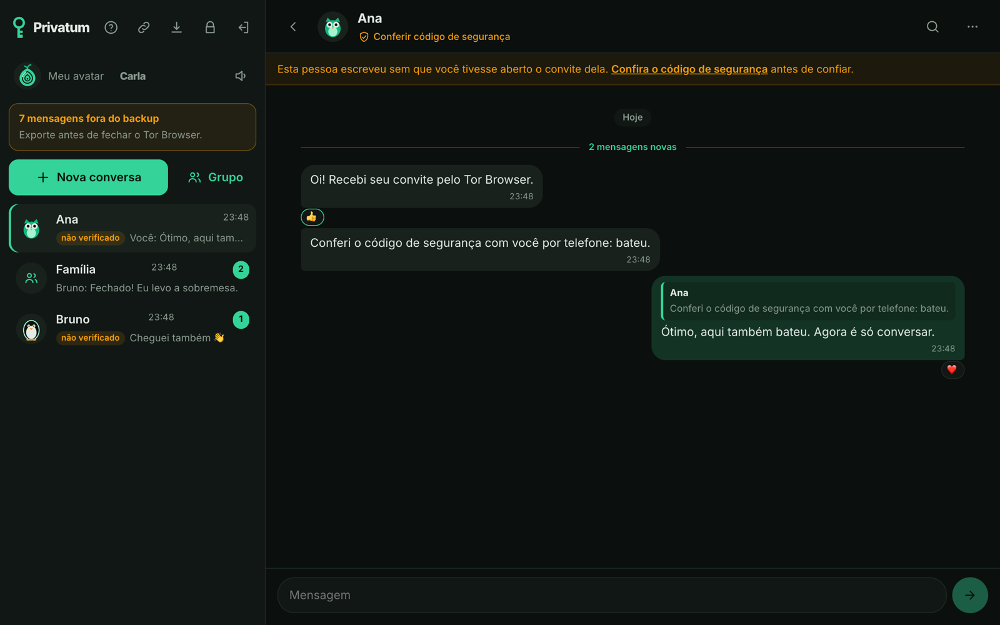
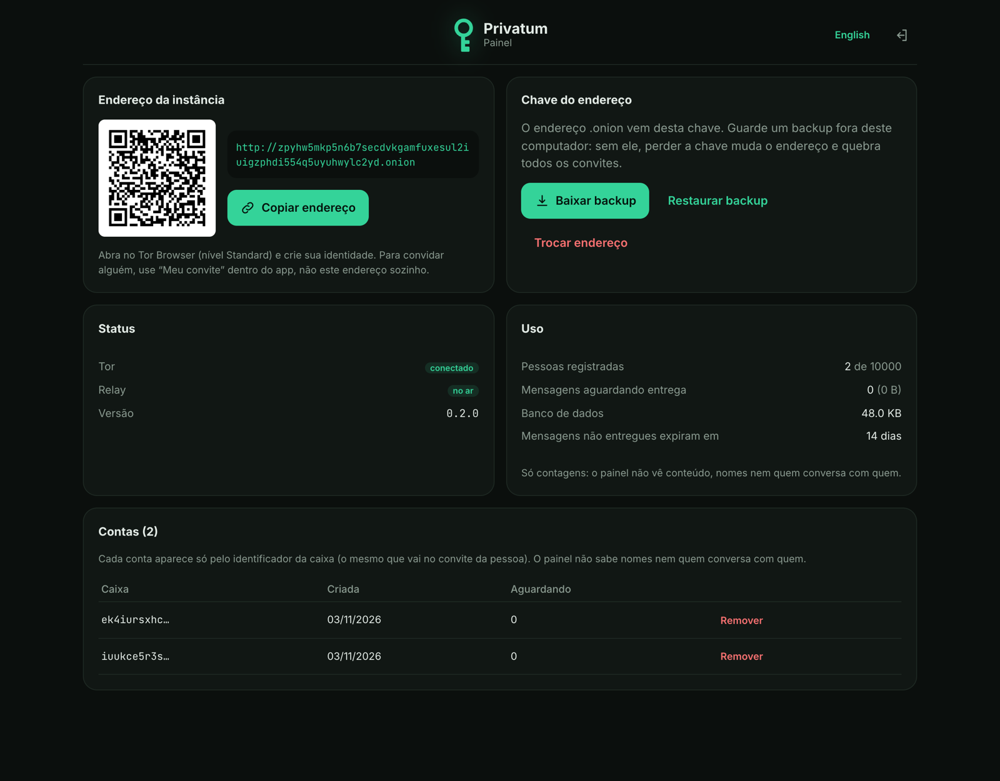
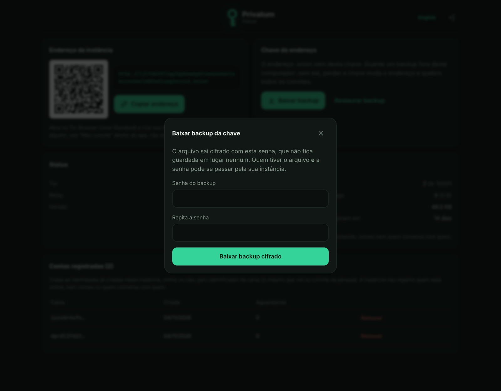
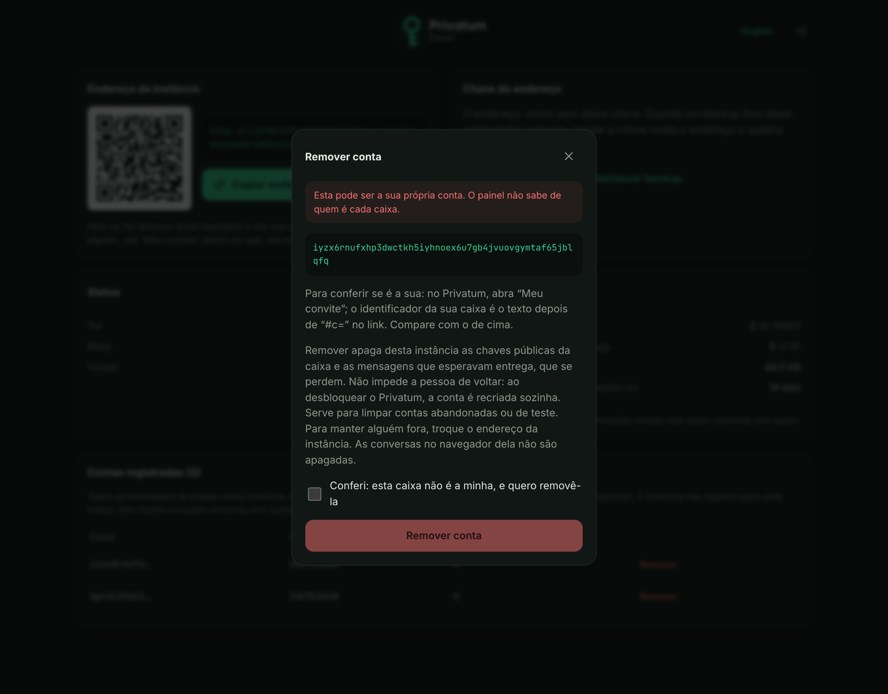
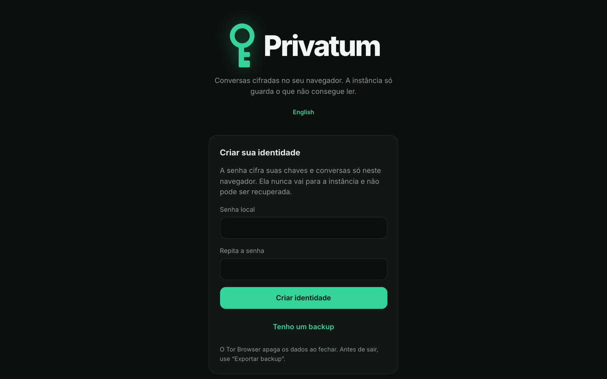
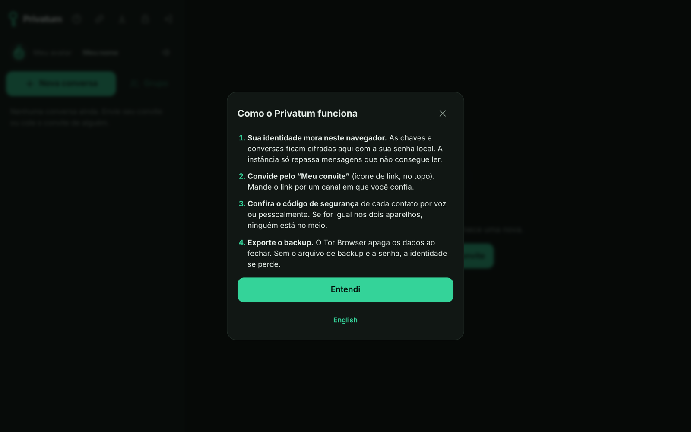
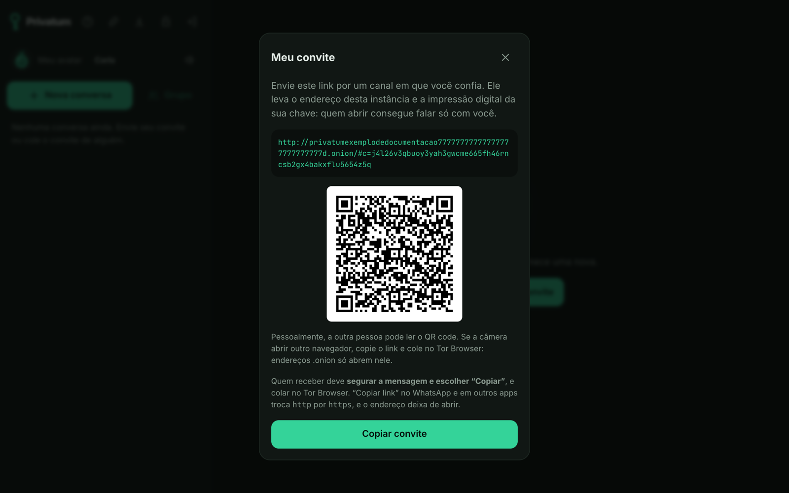
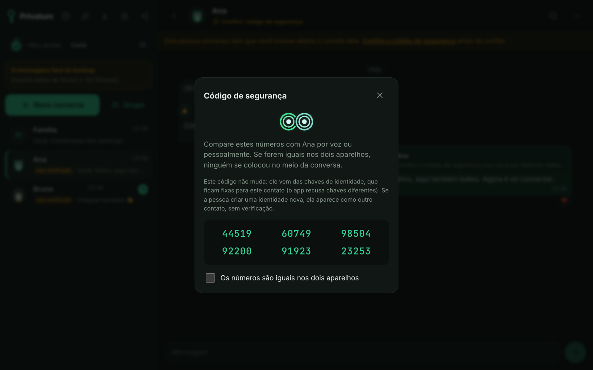
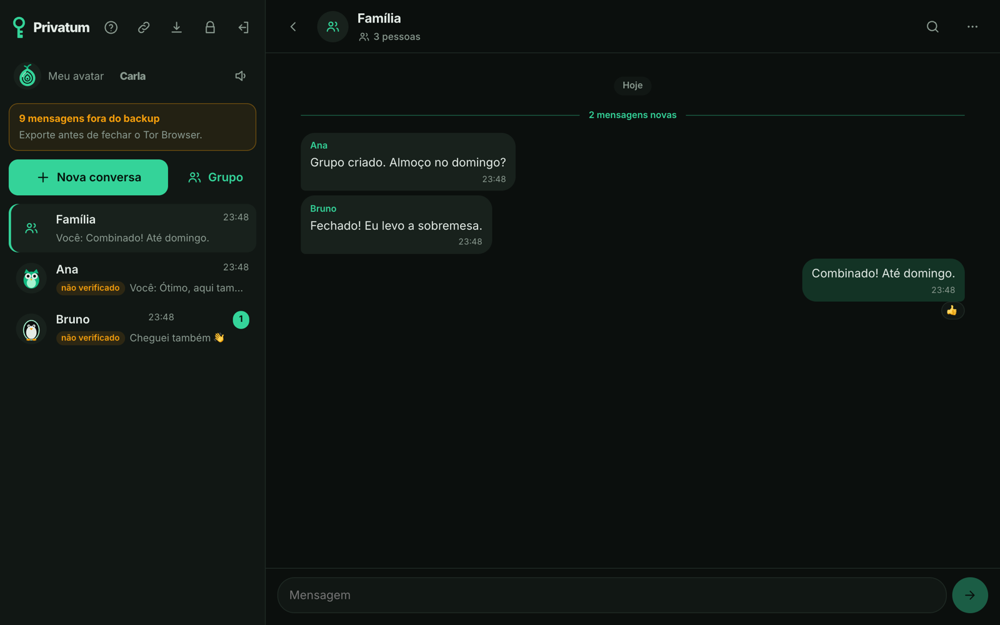
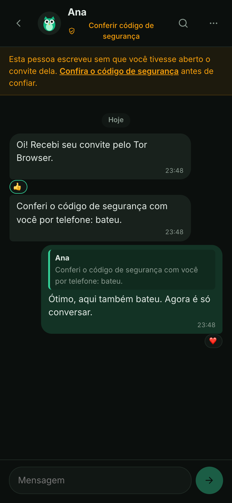

# Privatum (self-hosted)

[Português](README.md) · **English**

An end-to-end encrypted chat that anyone can run on their own machine with Docker. The instance is published as a Tor onion service, and you invite people with a link that carries the `.onion` address and your key's fingerprint. AGPL-3.0 license, non-commercial.

> **Version 0.2.5.** The project **has not had an external audit**. Read [SECURITY.en.md](SECURITY.en.md) and [docs/THREAT-MODEL.md](docs/THREAT-MODEL.md) first: they say what the project protects and, above all, what it does **not** protect. The technical documents in `docs/` are in Portuguese.



<sub>Screens taken on a local test instance, with fictional contacts and an example `.onion` address. The app is shown in Portuguese; it also has an English mode.</sub>

## What Privatum does

| | |
|---|---|
| **Conversations** | One-to-one and groups (up to 20 people), encrypted in the browser with Olm/Double Ratchet. The instance only stores and delivers what it cannot read. |
| **Messages** | Quoted replies, reactions, edit, delete for me or for everyone, disappearing messages (1 hour, 1 day or 7 days) and history search. |
| **Contacts** | Invite by link or QR code, safety code to compare by voice, warning when someone uses one of your contacts' names, blocking. |
| **Profile** | Avatar (20 drawings, no photos) and a name you choose, both encrypted. |
| **Identity** | Stays only in your browser, encrypted with your local passphrase. Encrypted backup file to take it to another browser. |
| **Instance** | Local panel to see the address and the state of Tor and the relay, back up the address key and manage accounts. |
| **Language** | Portuguese and English. |

## Important: Tor Browser security level

The client **only works at Tor Browser's "Standard" security level**.

- **Why:** the cryptography (vodozemac's Olm/Double Ratchet) runs in **WebAssembly**. Since Tor Browser 15, the **Safer** and **Safest** levels block WebAssembly on every site (Safest also blocks JavaScript). Without WebAssembly there is no cryptography: instead of opening, Privatum shows the steps to go back to Standard.
- **You cannot raise the level without breaking the client.** There is currently no tested and recommended Tor Browser setting that keeps Safer/Safest and allows WebAssembly for this site only.
- **What it costs:** the Standard level leaves more browser features on, so more attack surface. In practice: use Tor Browser only for Privatum while you chat, keep it updated and close it when you are done.

How to change it: shield icon next to the address bar (on Android: menu ⋮ → Settings → Privacy and security) → **Security settings** → **Standard**, then reload the page.

## Who needs what

| Role | Needs | System |
|---|---|---|
| **Whoever hosts** the instance | Docker | Windows, macOS or Linux |
| **Whoever chats** (including the host) | Tor Browser at the Standard level | Windows, macOS, Linux or Android (**not iPhone or iPad**: see [On the phone](#on-the-phone)) |

Nobody needs to open router ports or have a domain, a fixed IP or a TLS certificate: Tor takes care of that.

## Simple install (recommended)

No Git and no compiling: only Docker and the ready-made package from the [Releases](../../releases) page. Pick your system below. After installing, go to [After starting](#after-starting).

### Windows 10/11

1. Install [Docker Desktop for Windows](https://docs.docker.com/desktop/setup/install/windows-install/). Accept **WSL 2** when the installer asks, and restart the computer if it asks.
2. Open **Docker Desktop** and wait until it shows **Engine running** at the bottom.
3. Download the latest `privatum-vX.Y.Z.zip` from [Releases](../../releases).
4. Right-click the file → **Extract All…** → **Extract**.
5. In the extracted folder, double-click **`iniciar.bat`** ("start"). If Windows shows "Windows protected your PC", click **More info** → **Run anyway**.
6. A black window shows the progress. The first time, it downloads the images (about 200 MB). At the end, the [panel](#the-panel) opens in the browser.

To stop: double-click `parar.bat` ("stop").

### macOS (Apple Silicon or Intel)

1. Install [Docker Desktop for Mac](https://docs.docker.com/desktop/setup/install/mac-install/), choosing the version for your processor (Apple Silicon or Intel).
2. Open **Docker Desktop** from the Applications folder and wait until it shows it is running.
3. Download the latest `privatum-vX.Y.Z.zip` from [Releases](../../releases) and double-click it to extract (Safari may extract it on its own).
4. In the extracted folder, **right-click** **`iniciar.command`** → **Open** → **Open**. The first time it must be done this way, because macOS blocks scripts downloaded from the internet; afterwards a double-click is enough.
5. A Terminal window shows the progress. The first time, it downloads the images (about 200 MB). At the end, the [panel](#the-panel) opens in the browser. **In Safari**, if it does not open, type `http://127.0.0.1:8099` in the address bar, with the `http://` in front: without it Safari tries `https://` and fails. Chrome and Firefox open it directly.

To stop: double-click `parar.command`.

### Linux (Debian, Ubuntu or Kali)

The commands below install Docker from Docker's official repository, which already includes `docker compose`. Copy and paste them into the terminal, one block at a time.

1. Tell the terminal which system you have, by running **only one** of these lines:

   ```bash
   D=ubuntu; C=$(. /etc/os-release; echo $VERSION_CODENAME)   # Ubuntu
   ```

   ```bash
   D=debian; C=$(. /etc/os-release; echo $VERSION_CODENAME)   # Debian
   ```

   ```bash
   D=debian; C=bookworm                                       # Kali
   ```

2. Install Docker (in the **same** terminal as step 1):

   ```bash
   sudo apt update && sudo apt install -y ca-certificates curl unzip
   sudo install -m 0755 -d /etc/apt/keyrings
   sudo curl -fsSL https://download.docker.com/linux/$D/gpg -o /etc/apt/keyrings/docker.asc
   echo "deb [arch=$(dpkg --print-architecture) signed-by=/etc/apt/keyrings/docker.asc] https://download.docker.com/linux/$D $C stable" | sudo tee /etc/apt/sources.list.d/docker.list
   sudo apt update && sudo apt install -y docker-ce docker-ce-cli containerd.io docker-compose-plugin
   ```

3. Turn on the Docker service (Kali does not start services on its own) and let your user run Docker without `sudo`:

   ```bash
   sudo systemctl enable --now docker && sudo usermod -aG docker $USER
   ```

   Then **log out and back in** (or restart). Check that Docker answers without `sudo` and that Compose is version 2 or newer:

   ```bash
   docker info --format 'Docker {{.ServerVersion}} OK' && docker compose version
   ```

   It should show `Docker … OK` and `Docker Compose version v2` or newer (for example `v5.8.0`). If you see **permission denied**, you have not logged out and back in yet (or run `newgrp docker` and test again). If you see **Cannot connect to the Docker daemon**, run `sudo systemctl enable --now docker` again.

4. Download the latest version and start it. The command finds the newest package in [Releases](../../releases) by itself and extracts it into your home folder (`~/privatum-v…`):

   ```bash
   U=$(curl -fsSL https://api.github.com/repos/privatum-app/privatum-selfhosted/releases | grep -o 'https://[^"]*/privatum-v[^"]*\.zip' | head -1) && cd ~ && curl -fLO "$U" && Z=$(basename "$U") && unzip -o "$Z" && cd "${Z%.zip}" && ./iniciar.sh
   ```

5. The first time, it downloads the images (about 200 MB). At the end, the [panel](#the-panel) opens in the browser at `http://127.0.0.1:8099`. On a server without a screen, open the panel from your own computer through an SSH tunnel, `ssh -L 8099:127.0.0.1:8099 user@server`, and go to the same address.

To stop: `./parar.sh` inside the `~/privatum-v…` folder. To start again later: `./iniciar.sh` in the same folder.

### After starting

1. In the [panel](#the-panel), create the panel password and copy your instance's **`.onion` address**.
2. Open that address in [Tor Browser](https://www.torproject.org/download/) at the **Standard** security level, create your identity and send your invite. Continue in [Chatting](#chatting).
3. **Back up the address key** in the panel and keep the file off this computer: without it, losing the key changes the address and breaks every invite.

Stopping deletes nothing: the data and the `.onion` address stay stored in Docker. The instance is only online while the computer is on and Docker is running. To **update**, download the new version's package and run its `iniciar`: the data stays the same. The images are signed and come with an SBOM; how to check them is in [docs/OPERATIONS.md](docs/OPERATIONS.md#conferir-as-imagens) (in Portuguese).

## Hosting from source

For anyone who wants to build everything locally or contribute. Requirements: about **6 GB of free disk** during the first build (the final images take ~200 MB) and an internet connection. The first build takes **several minutes**, because it compiles the Rust relay and the WebAssembly cryptography inside the containers; you do not need to install Rust or Node.

### 1. Install Docker and Git

- **Windows 10/11:** install [Docker Desktop](https://docs.docker.com/desktop/setup/install/windows-install/) (with the **WSL 2** backend) and [Git for Windows](https://git-scm.com/download/win). Open Docker Desktop and wait until it shows it is running.
- **macOS:** install [Docker Desktop](https://docs.docker.com/desktop/setup/install/mac-install/) (Apple Silicon or Intel) and Git (`xcode-select --install` installs Apple's Git). Open Docker Desktop.
- **Linux:** install [Docker Engine](https://docs.docker.com/engine/install/) with the Compose plugin, and Git from your distribution's package manager. To run without `sudo`, add your user to the `docker` group and log out and back in.

Check in the terminal (PowerShell on Windows):

```bash
docker compose version
```

### 2. Get the project and start the instance

```bash
git clone https://github.com/privatum-app/privatum-selfhosted.git
```

```bash
cd privatum-selfhosted/deploy
```

```bash
docker compose up -d
```

### 3. Open the panel

Open **`http://127.0.0.1:8099`** in a regular browser on this computer or, in **Docker Desktop**, click the **8099:8080** link under **Containers → privatum → admin-1** (Docker shows "port on this computer : port inside the container"; the one you open is **8099**, and only from this computer). On the first visit you create the panel password. See [The panel](#the-panel).

In **Safari**, type the address with `http://` and bookmark it: from the Docker Desktop link it tries `https://` and does not open. Chrome and Firefox open it from the link.

The `.onion` address also shows up in the terminal, with:

```bash
docker compose exec tor cat /run/onion/hostname
```

and in the logs (**Docker Desktop → Containers → privatum → tor-1 → Logs**, look for "Seu Privatum está no ar", "Your Privatum is online"). The first time, Tor may take a minute or two to publish the service.

**This address identifies your instance.** The key that generates it lives in the `privatum_tor-state` volume. Back it up through the panel: if you lose it, the address changes and every invite stops working.

### Stop, restart, update, delete

| Action | Command (inside `deploy/`) |
|---|---|
| Stop (keeps data and address) | `docker compose down` |
| Start again | `docker compose up -d` |
| Update | `git pull`, then `docker compose up -d --build` |
| Change the `.onion` address | through the panel; see [docs/OPERATIONS.md](docs/OPERATIONS.md#trocar-o-endereço-onion) |
| **Delete everything**, including the `.onion` address and pending messages | `docker compose down -v` |

The instance is only available while the computer is on and the containers are running. Messages sent to someone who is offline are kept encrypted for up to 14 days.

## The panel

The panel only opens **on this computer** (`127.0.0.1:8099`); nobody reaches it through the `.onion` address. It never sees content, names or who talks to whom: only counts and mailbox identifiers.



| Card | What it is for |
|---|---|
| **Instance address** | The `.onion` address with a QR code and a copy button. It is what you open in Tor Browser. |
| **Address key** | **Download backup** of the key, encrypted (keep it off the computer), **Restore backup** and **Change address**. On restore, the panel checks that the key matches the address before saving it. |
| **Status** | Whether Tor is connected and the relay is up, and the installed version. |
| **Usage** | Registered people, messages waiting for delivery, database size and expiry time. |
| **Registered accounts** | Every identity ever created on the instance, online or not, by mailbox identifier. The instance does not record who is online. **Remove** deletes the mailbox and its pending messages, but **does not stop the person from coming back**: the account is recreated on its own, with the same identity, as soon as their Privatum connects (with the app open, they see a notice). It is for cleaning up abandoned or test accounts; to keep someone out, change the address. |

<table>
<tr>
<td width="50%"></td>
<td width="50%"></td>
</tr>
<tr>
<td>The backup leaves the browser encrypted with a passphrase of yours.</td>
<td>Removing asks for confirmation: the account might be yours. To check, compare it with the text after <code>#c=</code> in your "My invite".</td>
</tr>
</table>

Security and operation details of the panel are in [docs/OPERATIONS.md](docs/OPERATIONS.md#painel) (in Portuguese).

## Chatting

1. Download Tor Browser **only** from [torproject.org/download](https://www.torproject.org/download/) and, if you can, [verify its signature](https://support.torproject.org/tbb/how-to-verify-signature/).
2. Set the security level to **Standard** (see above).
3. Open the instance's `.onion` address and create an identity with a **local passphrase**. It encrypts your keys and conversations in this browser only, is never sent to the server and **cannot be recovered**. On the first visit the page may be slow or say "the connection has timed out": wait two minutes and try again ([when it does not open](docs/OPERATIONS.md#quando-o-endereço-onion-não-abre), in Portuguese).
4. Click **My invite** and send the link, over a channel you trust, to the person you want to add. They open the link in Tor Browser, create their identity, and the app opens **New conversation** with your invite already filled in. The person receiving it only needs Tor Browser: **they do not install Docker or Privatum**.

   **Careful when copying the invite on a phone:** the person should **long-press the message and choose "Copy"**, then paste it into Tor Browser's address bar. The **"Copy link"** option in WhatsApp (and other apps) changes `http://` to `https://`, and the address stops opening. The invite must start with `http://`; over Tor the connection is already encrypted end to end.
5. In the conversation, open **Check safety code** and compare the 30 digits with your contact, by voice or in person.
6. **Before closing Tor Browser, click "Export backup"** (download icon). Tor Browser deletes site data when it closes: without the `.privatum` file, your identity, contacts and history are lost. Next time, open the address and use **I have a backup** with the same local passphrase.

The backup is encrypted with your local passphrase; anyone who has the file can try to guess it offline, so use a long passphrase and keep the file somewhere safe. Restoring an old backup loses the messages exchanged after it.

<table>
<tr>
<td width="50%"></td>
<td width="50%"></td>
</tr>
<tr>
<td>First screen: the identity is created and encrypted in the browser.</td>
<td>Right after, a summary of how it works (reopened with the "?" button).</td>
</tr>
<tr>
<td></td>
<td></td>
</tr>
<tr>
<td>"My invite": link and QR code with the instance address and your key.</td>
<td>Safety code: compare the 30 digits with the other person.</td>
</tr>
</table>

### Groups



- **Group** (next to "New conversation") creates a group with up to 19 of your contacts. Each message is encrypted separately for each member; the instance does not know the group exists.
- Only the person who created the group adds or removes people and changes the disappearing-message timer. Anyone can leave. If the creator leaves or deletes the group, it is **ended for everyone**: members are notified, nobody can write in it anymore and the history becomes read-only. Members see the list and everyone's messages, including from people who are not their contacts (shown by the name they chose, marked "not your contact"). To check someone's identity, add that person's invite and compare the safety code.

### Replies, reactions and disappearing messages

- **Tap a message → Reply** to quote it. Only the reference travels: each device shows the text from its own history, so nobody can "quote" something you did not write.
- **Reactions:** 👍 ❤️ 😂 😮 😢 🙏 (tap again to remove).
- **Disappearing messages** (the conversation's ⋯ menu): 1 hour, 1 day or 7 days. New messages disappear from everyone's devices after the time is up. It does not prevent screenshots or copies in backups made earlier, and the encrypted copy not yet delivered stays on the instance until delivery (14 days at most).

### Edit and delete

**Tap a message** to see the actions. On yours: **Edit** and **Delete for everyone**; on any message: **Delete for me**. "Delete for everyone" is a request to the other devices: it does not guarantee that nobody saw it, took a screenshot or has an earlier backup.

### QR invite, repeated name and search

- **QR code:** "My invite" also shows a QR code. If the phone's camera opens another browser, copy the link and paste it into Tor Browser: `.onion` addresses only open there.
- **Repeated name:** if someone not yet verified picks the same name as one of your contacts, the conversation shows a red warning. It may be someone pretending to be that person, or that person with a new identity; check the safety code through another channel. A contact's code never changes: it comes from the identity keys, and the app refuses different keys.
- **Search** (magnifying glass at the top of the conversation): searches this device's history, ignoring case and accents.

### Avatar, name and sound

- **My avatar:** one of 20 drawings (the Privatum key, penguin, owl, Tor onion and others); whoever does not choose shows up with an onion. It travels encrypted inside the messages. Photos are not accepted, on purpose (phone photos carry location and other metadata).
- **My name:** the name your contacts see, also encrypted. It shows on a contact's device only if they did not give you another name when adding your invite; the name each person types always wins.
- **Sound:** a short chime for each new message; the tab title shows the unread total. The browser only allows sound after a click, and the click on "Unlock" counts. The speaker icon mutes it. On Android, with Tor Browser in the background or the screen off, the system pauses the page and there is no sound.

### Lock, log out, delete and block

- **Lock** (padlock): goes back to the passphrase screen; the identity stays in this browser until it is closed.
- **Log out** (door): deletes the identity, contacts and conversations from this browser. The warning offers to export the backup first; without it there is no way back. Closing Tor Browser has the same effect.
- **Delete conversation:** removes the contact and the history from this device only. If the person writes again, the conversation reappears as "not verified".
- **Block:** deletes the conversation and discards, unread, everything this person sends. To unblock, add their invite again. Blocking is local: the instance still accepts their messages and your device discards them.

### Language

The app and the panel are in Portuguese and English. The **English / Português** button is on the first screen, in the "How it works" (?) window and at the top of the panel. The choice is stored only in this browser. The language is not detected automatically: Tor Browser reports English to every site, so that users cannot be identified by their language.

### On the phone



In Tor Browser for Android, the conversation list and the conversation take the full screen, one at a time; the arrow at the top goes back to the list. **iPhone and iPad are not supported.** There is no official Tor Browser for them, and every browser there, Onion Browser included, uses Safari's engine, which does not offer the browser's cryptography (WebCrypto) on `http://….onion` addresses. Without it Privatum cannot protect local data, so it shows the "This browser is not supported" screen. Use Tor Browser on a computer or on Android.

## Tested so far

| | Status |
|---|---|
| Hosting on macOS (Apple Silicon), including the v0.1.0 simple package | tested |
| Hosting on Linux with the v0.2.3 simple package (Kali ARM64 in VirtualBox) | tested: install from the README, Android ↔ macOS chat, accounts in the panel, stop/start keeping address and conversations, key backup |
| Hosting on Windows | **not tested** (images published for amd64 and arm64; the amd64 one was built and run) |
| Chatting in Tor Browser on a computer and on Android (15.0.24, 4G and Wi-Fi) | tested (v0.1 features) |
| Message sent while the recipient was offline and received after restoring the backup | tested (Android → macOS) |
| Panel: address, backup, restore and address change, accounts | tested (test instance and real instance on macOS) |
| Groups (including ending a group), reactions, search, avatar, English, account removed through the panel with the app open | tested in Tor Browser (Android and macOS) |
| Replies, disappearing messages, name change, repeated name | tested by automated tests and in a local browser; **still to check in Tor Browser** |
| Tor Browser Safer level (should show the help screen) | tested |
| Simple package (Linux: v0.2.3) | tested on Linux; **Windows still to do** |
| Onion Browser (iPhone) | tested: **not supported** (no WebCrypto on `.onion`); the app shows a notice |
| Brave with Tor | **not tested** |

## How it works

- **Messages:** Olm (Double Ratchet) from [vodozemac](https://github.com/matrix-org/vodozemac), compiled to WebAssembly. This project implements no cryptography of its own.
- **Relay:** a Rust server that only stores and delivers encrypted envelopes. It never receives passwords or private keys. Details in [docs/PROTOCOL.md](docs/PROTOCOL.md) (in Portuguese).
- **Identity:** each person's address is the hash of their public keys, so the client refuses keys swapped by the server.
- **Groups:** they do not exist for the relay; each message is encrypted for each member over the one-to-one sessions.
- **Network:** C Tor in a container publishes the instance as `.onion`. The only port open on the computer is the panel's, bound to the local address.

## Layout

| Folder | Contents |
|---|---|
| `relay/` | Rust relay (axum + SQLite), local panel (`src/bin/privatum-admin.rs`) and tests |
| `crypto-wasm/` | `wasm-bindgen` glue over vodozemac, and tests |
| `client/` | Web client and panel (React); the logic lives in `client/src/core/`, without React |
| `deploy/` | Images, `compose.yaml`, Tor configuration and the simple package |
| `docs/` | Threat model, protocol, operations and images (in Portuguese) |

## Tests (for developers)

Everything builds inside Docker; you do not need to install Rust.

```bash
docker run --rm -v "$PWD/relay":/src -w /src rust:1.90-bookworm cargo test
```

```bash
docker run --rm -v "$PWD/crypto-wasm":/src -w /src rust:1.90-bookworm cargo test
```

```bash
docker build -f deploy/relay.Dockerfile --target wasm-out --output crypto-wasm/pkg .
```

```bash
node --test crypto-wasm/tests/*.test.mjs
```

End to end (client against a real relay):

```bash
docker build -f deploy/relay.Dockerfile -t privatum-relay:local .
```

```bash
docker run -d --name privatum-e2e -e PRIVATUM_HOST=localhost:18080 -p 127.0.0.1:18080:8080 privatum-relay:local
```

```bash
PRIVATUM_TEST_BASE=http://localhost:18080 node --test client/test/*.test.ts
```

## License

[AGPL-3.0](LICENSE). Non-commercial project.
