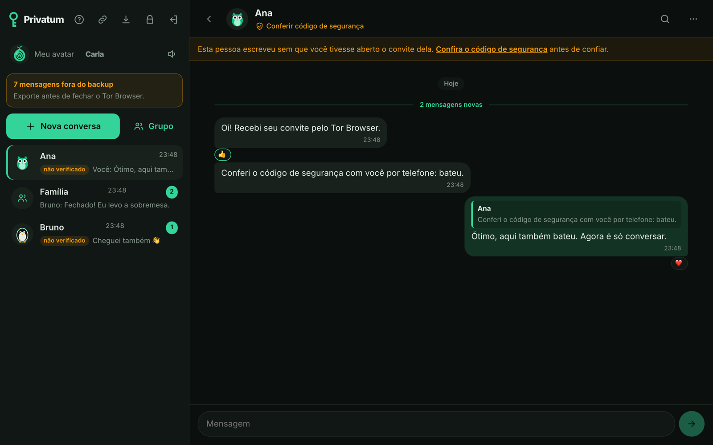
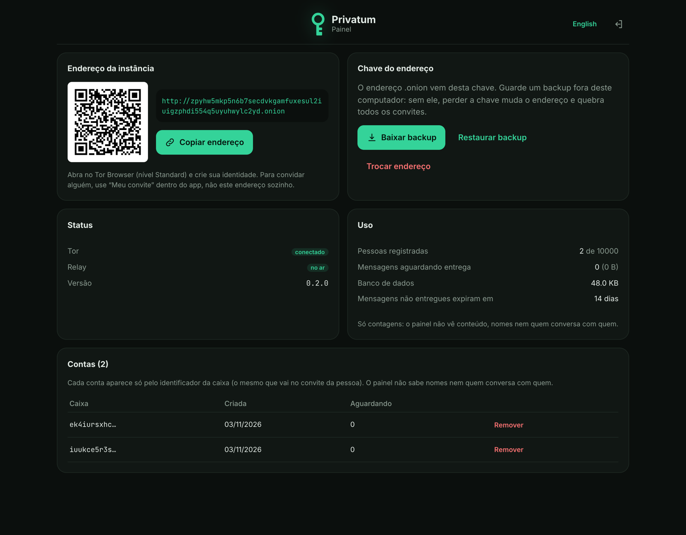
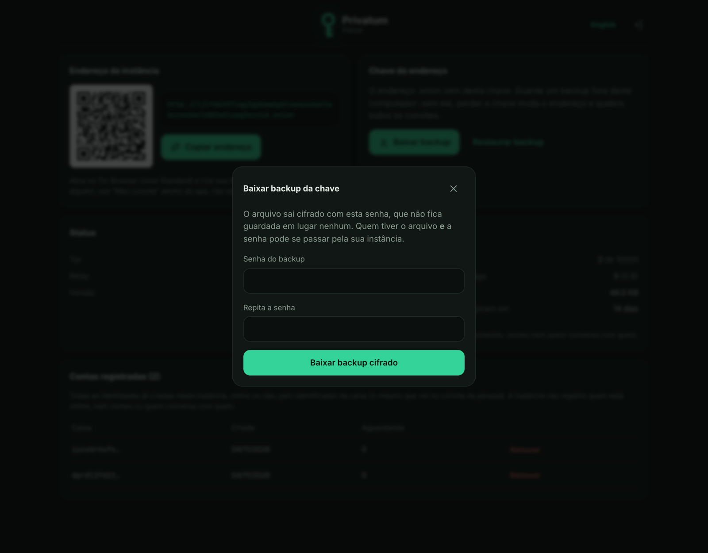
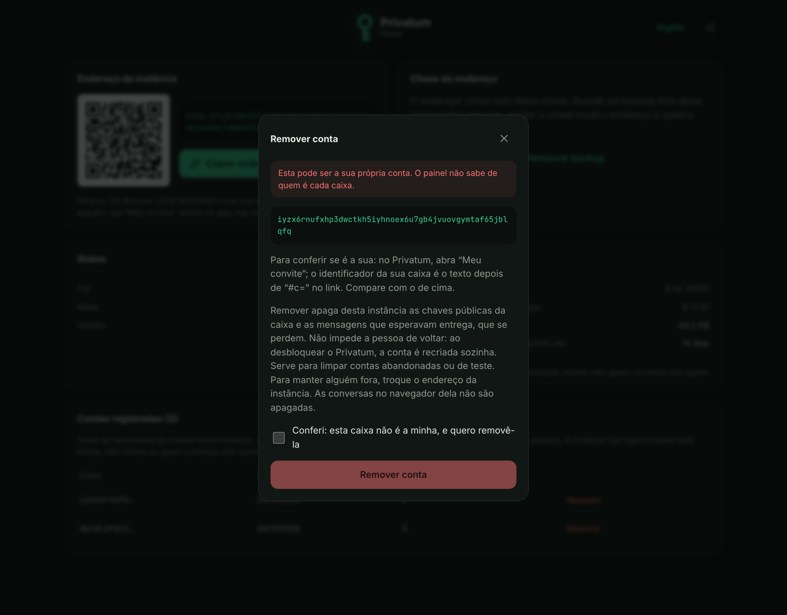
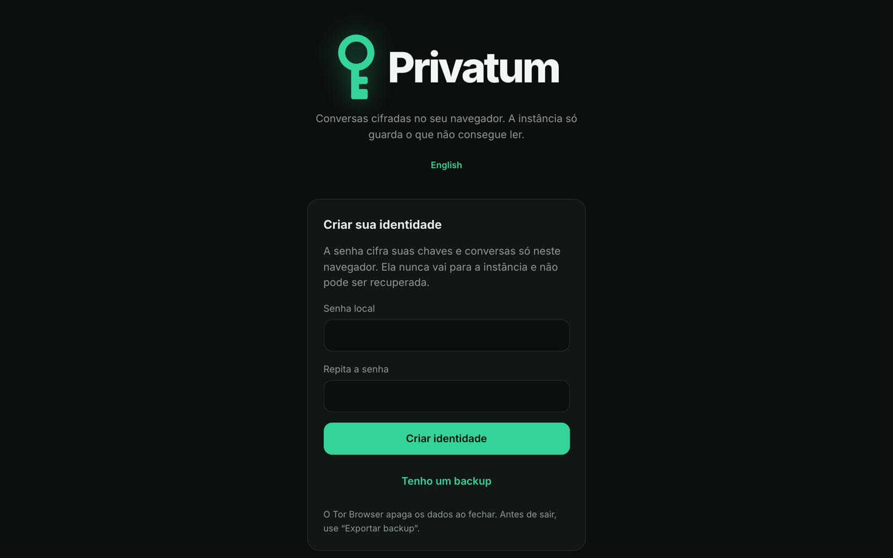
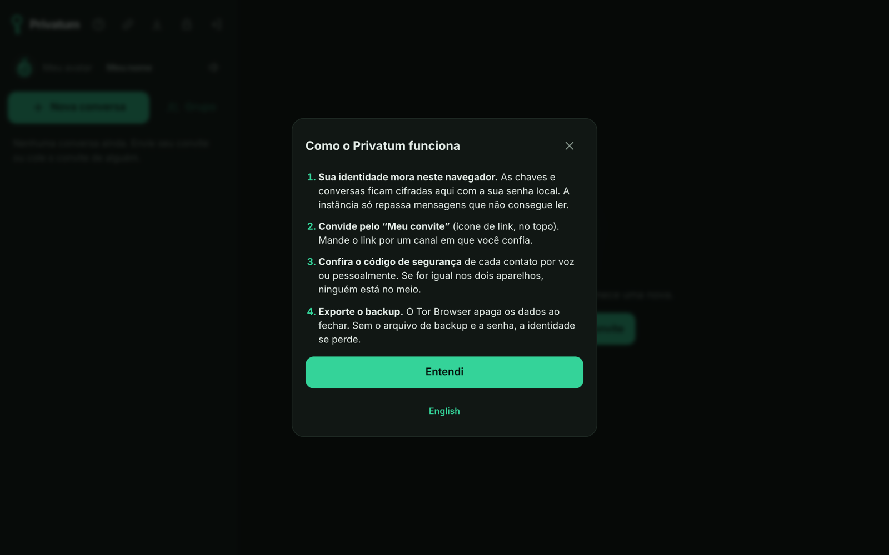
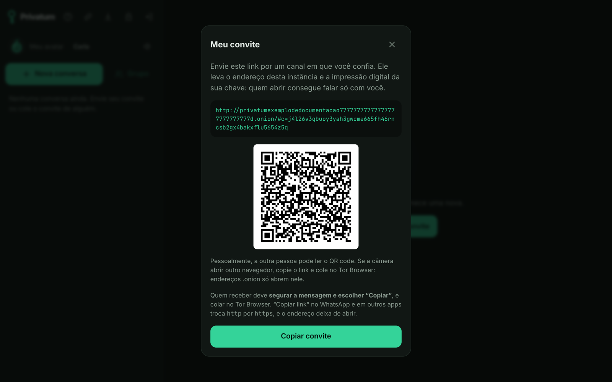
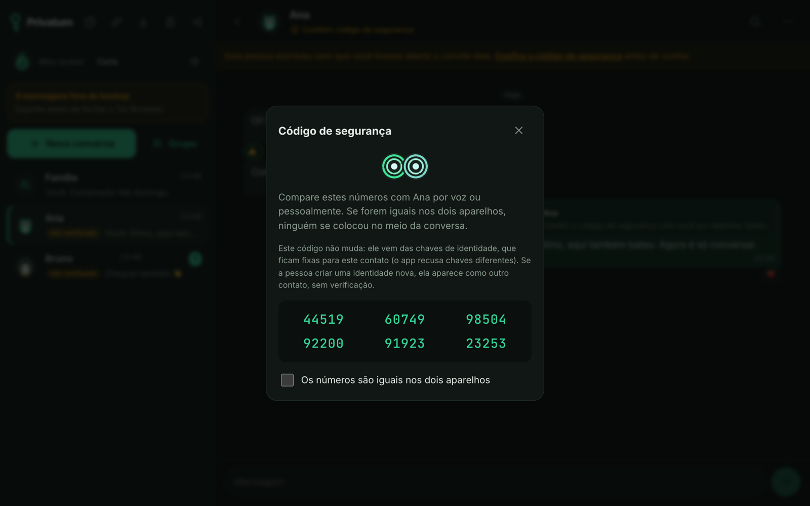
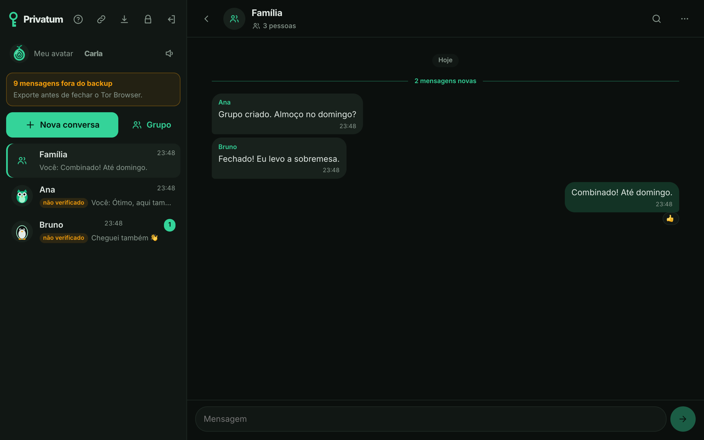
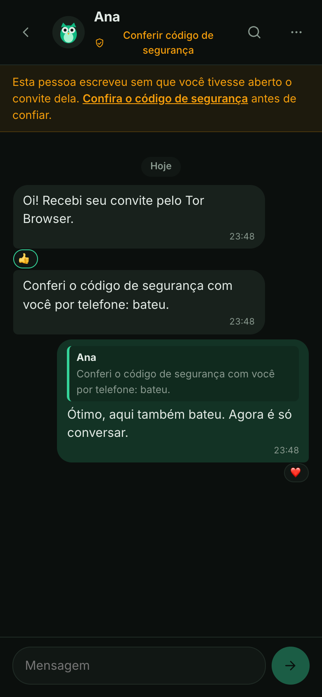

# Privatum (autohospedado)

Chat com criptografia de ponta a ponta que qualquer pessoa sobe na própria máquina com Docker. A instância é publicada como serviço onion do Tor e você convida pessoas por um link que leva o endereço `.onion` e a impressão digital da sua chave. Licença AGPL-3.0, sem fins comerciais.

> **Versão 0.2.3: funcionalidades fechadas, em fase de testes.** É pré-alfa e **não passou por auditoria externa. Não use para nada sensível.** Leia [SECURITY.md](SECURITY.md) e [docs/THREAT-MODEL.md](docs/THREAT-MODEL.md) antes: lá está o que o projeto protege e, principalmente, o que **não** protege.



<sub>Telas feitas numa instância de teste local, com contatos fictícios e um endereço `.onion` de exemplo.</sub>

## O que o Privatum faz

| | |
|---|---|
| **Conversas** | Individuais e em grupo (até 20 pessoas), cifradas no navegador com Olm/Double Ratchet. A instância só guarda e entrega o que não consegue ler. |
| **Mensagens** | Responder citando, reações, editar, apagar para mim ou para todos, mensagens temporárias (1 hora, 1 dia ou 7 dias) e busca no histórico. |
| **Contatos** | Convite por link ou QR code, código de segurança para conferir por voz, aviso quando alguém usa o nome de um contato seu, bloqueio. |
| **Perfil** | Avatar (20 desenhos, sem fotos) e nome escolhido por você, ambos cifrados. |
| **Identidade** | Fica só no seu navegador, cifrada com a sua senha local. Backup cifrado em arquivo para levar a outro navegador. |
| **Instância** | Painel local para ver o endereço, o estado do Tor e do relay, fazer backup da chave do endereço e gerenciar contas. |
| **Idioma** | Português e inglês. |

## Importante: nível de segurança do Tor Browser

O cliente **só funciona no nível de segurança "Standard" (Padrão)** do Tor Browser.

- **Por quê:** a criptografia (Olm/Double Ratchet do vodozemac) roda em **WebAssembly**. Desde o Tor Browser 15, os níveis **Safer** e **Safest** bloqueiam WebAssembly em todos os sites (o Safest também bloqueia JavaScript). Sem WebAssembly não há criptografia: em vez de abrir, o Privatum mostra o passo a passo para voltar ao nível Padrão.
- **Não dá para subir o nível sem quebrar o cliente.** Não existe hoje uma configuração do Tor Browser que mantenha Safer/Safest e libere WebAssembly só para este site de forma testada e recomendada.
- **O que isso custa:** o nível Standard deixa o navegador com mais recursos ativos, logo com mais superfície de ataque. Na prática: use o Tor Browser só para o Privatum enquanto conversa, mantenha-o atualizado e feche-o ao terminar.

Como mudar: ícone do escudo ao lado da barra de endereço (no Android: menu ⋮ → Configurações → Privacidade e segurança) → **Configurações de segurança** → **Padrão**, e recarregue a página.

## Quem precisa de quê

| Papel | Precisa de | Sistema |
|---|---|---|
| **Quem hospeda** a instância | Docker | Windows, macOS ou Linux |
| **Quem conversa** (inclusive quem hospeda) | Tor Browser no nível Standard | Windows, macOS, Linux ou Android |

Ninguém precisa abrir portas no roteador, ter domínio, IP fixo ou certificado TLS: o Tor cuida disso.

## Instalação simples (recomendada)

Não precisa de Git, terminal nem compilar nada; só do Docker.

1. Instale o **Docker Desktop** ([Windows](https://docs.docker.com/desktop/setup/install/windows-install/), [macOS](https://docs.docker.com/desktop/setup/install/mac-install/)) ou, no Linux, o [Docker Engine](https://docs.docker.com/engine/install/) com o plugin Compose.
2. Baixe o arquivo `privatum-vX.Y.Z.zip` na página de [Releases](../../releases) e extraia em uma pasta qualquer.
3. Dê **dois cliques** no atalho do seu sistema:
   - **Windows:** `iniciar.bat`
   - **macOS:** `iniciar.command` (na primeira vez, clique com o botão direito → **Abrir**, porque o macOS bloqueia scripts baixados da internet)
   - **Linux:** `iniciar.sh`
4. Na primeira vez ele baixa as imagens prontas (cerca de 200 MB). No fim, abre no navegador o [painel](#o-painel) com o **endereço `.onion`** da sua instância. Siga daí para [Conversar](#conversar).

Para parar: `parar.bat`, `parar.command` ou `parar.sh`. Seus dados e o endereço são mantidos. As imagens são assinadas e trazem SBOM; como conferir está em [docs/OPERATIONS.md](docs/OPERATIONS.md#conferir-as-imagens).

## Hospedar a partir do código-fonte

Para quem quer compilar tudo localmente ou contribuir. Requisitos: cerca de **6 GB livres** de disco durante o primeiro build (as imagens finais ocupam ~200 MB) e conexão com a internet. O primeiro build leva **vários minutos**, porque compila o relay em Rust e a criptografia em WebAssembly dentro dos contêineres; não é preciso instalar Rust nem Node.

### 1. Instale o Docker e o Git

- **Windows 10/11:** instale o [Docker Desktop](https://docs.docker.com/desktop/setup/install/windows-install/) (com o backend **WSL 2**) e o [Git for Windows](https://git-scm.com/download/win). Abra o Docker Desktop e espere ele indicar que está rodando.
- **macOS:** instale o [Docker Desktop](https://docs.docker.com/desktop/setup/install/mac-install/) (Apple Silicon ou Intel) e o Git (`xcode-select --install` instala o Git da Apple). Abra o Docker Desktop.
- **Linux:** instale o [Docker Engine](https://docs.docker.com/engine/install/) com o plugin Compose e o Git pelo gerenciador de pacotes da sua distribuição. Para rodar sem `sudo`, adicione seu usuário ao grupo `docker` e faça logout/login.

Confira no terminal (PowerShell no Windows):

```bash
docker compose version
```

### 2. Baixe o projeto e suba a instância

Enquanto o repositório for privado, só contas com acesso conseguem clonar.

```bash
git clone https://github.com/privatum-app/privatum-selfhosted.git
```

```bash
cd privatum-selfhosted/deploy
```

```bash
docker compose up -d
```

### 3. Abra o painel

Abra **`http://127.0.0.1:8099`** no navegador comum deste computador, ou, no **Docker Desktop**, clique no link **8099:8080** em **Containers → privatum → admin-1**. No primeiro acesso você cria a senha do painel. Veja [O painel](#o-painel).

No **Safari**, digite o endereço com `http://` e salve nos favoritos: pelo link do Docker Desktop ele tenta `https://` e não abre. Chrome e Firefox abrem pelo link.

O endereço `.onion` também aparece no terminal, com:

```bash
docker compose exec tor cat /run/onion/hostname
```

e nos logs (**Docker Desktop → Containers → privatum → tor-1 → Logs**, procure “Seu Privatum está no ar”). Na primeira vez, o Tor pode levar um ou dois minutos para publicar o serviço.

**Esse endereço identifica a sua instância.** A chave que o gera fica no volume `privatum_tor-state`. Faça o backup dela pelo painel: se você a perder, o endereço muda e todos os convites deixam de funcionar.

### Parar, reiniciar, atualizar, apagar

| Ação | Comando (dentro de `deploy/`) |
|---|---|
| Parar (mantém dados e endereço) | `docker compose down` |
| Subir de novo | `docker compose up -d` |
| Atualizar | `git pull` e depois `docker compose up -d --build` |
| Trocar o endereço `.onion` | pelo painel; veja [docs/OPERATIONS.md](docs/OPERATIONS.md#trocar-o-endereço-onion) |
| **Apagar tudo**, inclusive o endereço `.onion` e mensagens pendentes | `docker compose down -v` |

A instância só fica disponível enquanto o computador estiver ligado e os contêineres rodando. Mensagens enviadas a quem está offline ficam guardadas cifradas por até 14 dias.

## O painel

O painel só abre **neste computador** (`127.0.0.1:8099`); pelo `.onion` ninguém chega a ele. Ele nunca vê conteúdo, nomes nem quem conversa com quem: só contagens e identificadores de caixa.



| Quadro | Para que serve |
|---|---|
| **Endereço da instância** | O endereço `.onion` com QR code e botão de copiar. É o que você abre no Tor Browser. |
| **Chave do endereço** | **Baixar backup** cifrado da chave (guarde fora do computador), **Restaurar backup** e **Trocar endereço**. Na restauração, o painel confere se a chave corresponde ao endereço antes de gravar. |
| **Status** | Se o Tor está conectado e o relay no ar, e a versão instalada. |
| **Uso** | Pessoas registradas, mensagens aguardando entrega, tamanho do banco e prazo de expiração. |
| **Contas registradas** | Todas as identidades já criadas na instância, online ou não, pelo identificador da caixa. A instância não registra quem está online. **Remover** apaga a caixa e as mensagens pendentes dela, mas **não impede a pessoa de voltar**: a conta é recriada sozinha, com a mesma identidade, assim que o Privatum dela se conecta (com o app aberto, ela vê um aviso). Serve para limpar contas abandonadas ou de teste; para manter alguém fora, troque o endereço. |

<table>
<tr>
<td width="50%"></td>
<td width="50%"></td>
</tr>
<tr>
<td>O backup sai cifrado do navegador com uma senha sua.</td>
<td>Remover pede confirmação: a conta pode ser a sua. Para conferir, compare com o texto depois de <code>#c=</code> no seu “Meu convite”.</td>
</tr>
</table>

Detalhes de segurança e operação do painel em [docs/OPERATIONS.md](docs/OPERATIONS.md#painel).

## Conversar

1. Baixe o Tor Browser **somente** em [torproject.org/download](https://www.torproject.org/download/) e, se puder, [verifique a assinatura](https://support.torproject.org/tbb/how-to-verify-signature/).
2. Coloque o nível de segurança em **Padrão (Standard)** (veja acima).
3. Abra o endereço `.onion` da instância e crie uma identidade com uma **senha local**. Ela cifra suas chaves e conversas só neste navegador, nunca é enviada ao servidor e **não pode ser recuperada**. Na primeira visita, a página pode demorar ou dar "a conexão expirou": espere dois minutos e tente de novo ([quando não abre](docs/OPERATIONS.md#quando-o-endereço-onion-não-abre)).
4. Clique em **Meu convite** e envie o link, por um canal em que você confia, a quem você quer adicionar. A pessoa abre o link no Tor Browser, cria a identidade dela e o app já abre a **Nova conversa** com o seu convite preenchido. Quem recebe só precisa do Tor Browser: **não instala Docker nem o Privatum**.

   **Atenção ao copiar o convite no celular:** a pessoa deve **segurar a mensagem e escolher "Copiar"** e colar na barra do Tor Browser. A opção **"Copiar link"** do WhatsApp (e de outros apps) troca `http://` por `https://`, e o endereço deixa de abrir. O convite precisa começar com `http://`; pelo Tor a conexão já é cifrada de ponta a ponta.
5. Na conversa, abra **Conferir código de segurança** e compare os 30 dígitos com o contato, por voz ou pessoalmente.
6. **Antes de fechar o Tor Browser, clique em "Exportar backup"** (ícone de download). O Tor Browser apaga os dados dos sites ao fechar: sem o arquivo `.privatum`, sua identidade, contatos e histórico se perdem. Da próxima vez, abra o endereço e use **Tenho um backup** com a mesma senha local.

O backup é cifrado com a sua senha local; quem tiver o arquivo pode tentar adivinhá-la offline, então use uma senha longa e guarde o arquivo em local seguro. Restaurar um backup antigo perde as mensagens trocadas depois dele.

<table>
<tr>
<td width="50%"></td>
<td width="50%"></td>
</tr>
<tr>
<td>Primeira tela: a identidade é criada e cifrada no navegador.</td>
<td>Logo depois, um resumo de como funciona (reaberto pelo botão “?”).</td>
</tr>
<tr>
<td></td>
<td></td>
</tr>
<tr>
<td>“Meu convite”: link e QR code com o endereço da instância e a sua chave.</td>
<td>Código de segurança: compare os 30 dígitos com a outra pessoa.</td>
</tr>
</table>

### Grupos



- **Grupo** (ao lado de "Nova conversa") cria um grupo com até 19 contatos seus. Cada mensagem é cifrada separadamente para cada membro; a instância não sabe que o grupo existe.
- Só quem criou o grupo adiciona ou remove pessoas e muda o prazo das mensagens temporárias. Qualquer um pode sair. Se quem criou sair ou apagar o grupo, ele é **encerrado para todos**: os membros são avisados, ninguém mais consegue escrever nele e o histórico fica só para leitura. Os membros veem a lista e as mensagens de todos, inclusive de quem não é seu contato (aparece pelo nome que escolheu, marcado como "não é seu contato"). Para conferir a identidade de alguém, adicione o convite dessa pessoa e compare o código de segurança.

### Responder, reagir e mensagens temporárias

- **Toque numa mensagem → Responder** para citá-la. Só a referência viaja: cada aparelho mostra o texto do próprio histórico, então ninguém consegue "citar" algo que você não escreveu.
- **Reações:** 👍 ❤️ 😂 😮 😢 🙏 (toque de novo para tirar).
- **Mensagens temporárias** (menu ⋯ da conversa): 1 hora, 1 dia ou 7 dias. As mensagens novas somem dos aparelhos de todos depois do prazo. Não impede captura de tela nem cópias em backups feitos antes, e a cópia cifrada ainda não entregue fica na instância até ser entregue (no máximo 14 dias).

### Editar e apagar

**Toque numa mensagem** para ver as ações. Nas suas: **Editar** e **Apagar para todos**; em qualquer uma: **Apagar para mim**. "Apagar para todos" é um pedido aos outros aparelhos: não garante que ninguém viu, fez captura de tela ou tem um backup anterior.

### Convite por QR, nome repetido e busca

- **QR code:** o "Meu convite" mostra também um QR code. Se a câmera do celular abrir outro navegador, copie o link e cole no Tor Browser: endereços `.onion` só abrem nele.
- **Nome repetido:** se alguém ainda não verificado escolhe o mesmo nome de um contato seu, a conversa mostra um aviso vermelho. Pode ser alguém se passando pela pessoa, ou ela com uma identidade nova; confira o código de segurança por outro meio. O código de um contato nunca muda: ele vem das chaves de identidade, e o app recusa chaves diferentes.
- **Busca** (lupa no topo da conversa): procura no histórico deste aparelho, sem diferenciar maiúsculas, minúsculas e acentos.

### Avatar, nome e som

- **Meu avatar:** um dos 20 desenhos (chave do Privatum, pinguim, coruja, cebola do Tor e outros); quem não escolhe aparece com uma cebola. Vai cifrado dentro das mensagens. Fotos não são aceitas, de propósito (fotos de celular carregam localização e outros metadados).
- **Meu nome:** o nome que seus contatos veem, também cifrado. Ele aparece no aparelho do contato só se ele não deu outro nome a você ao adicionar o convite; o nome que cada pessoa digita sempre prevalece.
- **Som:** um aviso curto a cada mensagem nova; o título da aba mostra o total de não lidas. O navegador só libera som depois de um clique, e o clique em "Desbloquear" já conta. O ícone de alto-falante silencia. No Android, com o Tor Browser em segundo plano ou a tela apagada, o sistema pausa a página e não há som.

### Trancar, sair, apagar e bloquear

- **Trancar** (cadeado): volta à tela de senha; a identidade continua neste navegador até ele ser fechado.
- **Sair** (porta): apaga a identidade, os contatos e as conversas deste navegador. O aviso oferece exportar o backup antes; sem ele, não há como voltar. Fechar o Tor Browser tem o mesmo efeito.
- **Apagar conversa:** remove o contato e o histórico só deste aparelho. Se a pessoa escrever de novo, a conversa reaparece como "não verificada".
- **Bloquear:** apaga a conversa e descarta, sem ler, tudo o que essa pessoa enviar. Para desbloquear, adicione o convite dela de novo. O bloqueio é local: a instância continua aceitando as mensagens dela e o seu aparelho as descarta.

### Idioma

O app e o painel estão em português e inglês. O botão **English / Português** fica na primeira tela, na janela "Como funciona" (?) e no topo do painel. A escolha fica guardada só neste navegador. O idioma não é detectado sozinho: o Tor Browser informa inglês a todos os sites, para não identificar quem usa pelo idioma.

### No celular



No Tor Browser para Android, a lista de conversas e a conversa ocupam a tela inteira, uma de cada vez; a seta no topo volta para a lista. No iPhone não há Tor Browser oficial; o Onion Browser ainda não foi testado.

## Testado até agora

| | Status |
|---|---|
| Hospedar no macOS (Apple Silicon), inclusive pelo pacote simples da v0.1.0 | testado |
| Hospedar no Windows ou Linux | **não testado** (imagens publicadas para amd64 e arm64; a de amd64 foi compilada e executada) |
| Conversar pelo Tor Browser no computador e no Android (15.0.24, 4G e Wi-Fi) | testado (funções da v0.1) |
| Mensagem enviada com o destinatário offline e recebida depois de restaurar o backup | testado (Android → macOS) |
| Painel: endereço, backup, restauração e troca do endereço, contas | testado (instância de teste e instância real no macOS) |
| Grupos (inclusive encerrar o grupo), reações, busca, avatar, inglês, conta removida pelo painel com o app aberto | testado no Tor Browser (Android e macOS) |
| Respostas, mensagens temporárias, troca de nome, nome repetido | testado em testes automáticos e num navegador local; **falta conferir no Tor Browser** |
| Nível Safer do Tor Browser (deve mostrar a tela de ajuda) | testado |
| Pacote simples da v0.2.3 | **não testado** |
| Onion Browser (iPhone), Brave com Tor | **não testado** |

## Como funciona

- **Mensagens:** Olm (Double Ratchet) do [vodozemac](https://github.com/matrix-org/vodozemac), compilado para WebAssembly. Este projeto não implementa criptografia própria.
- **Relay:** servidor em Rust que só guarda e entrega envelopes cifrados. Nunca recebe senha nem chave privada. Detalhes em [docs/PROTOCOL.md](docs/PROTOCOL.md).
- **Identidade:** o endereço de cada pessoa é o hash das suas chaves públicas, então o cliente recusa chaves trocadas pelo servidor.
- **Grupos:** não existem para o relay; cada mensagem é cifrada para cada membro pelas sessões de um para um.
- **Rede:** C Tor em contêiner publica a instância como `.onion`. A única porta aberta no computador é a do painel, presa ao endereço local.

## Estrutura

| Pasta | Conteúdo |
|---|---|
| `relay/` | Relay em Rust (axum + SQLite), painel local (`src/bin/privatum-admin.rs`) e testes |
| `crypto-wasm/` | Cola `wasm-bindgen` sobre o vodozemac e testes |
| `client/` | Cliente web e painel (React); a lógica fica em `client/src/core/`, sem React |
| `deploy/` | Imagens, `compose.yaml`, configuração do Tor e pacote simples |
| `docs/` | Modelo de ameaças, protocolo, operação e imagens |

## Testes (para quem desenvolve)

Tudo compila dentro do Docker; não é preciso instalar Rust.

```bash
docker run --rm -v "$PWD/relay":/src -w /src rust:1.90-bookworm cargo test
```

```bash
docker run --rm -v "$PWD/crypto-wasm":/src -w /src rust:1.90-bookworm cargo test
```

```bash
docker build -f deploy/relay.Dockerfile --target wasm-out --output crypto-wasm/pkg .
```

```bash
node --test crypto-wasm/tests/*.test.mjs
```

Ponta a ponta (cliente contra um relay real):

```bash
docker build -f deploy/relay.Dockerfile -t privatum-relay:local .
```

```bash
docker run -d --name privatum-e2e -e PRIVATUM_HOST=localhost:18080 -p 127.0.0.1:18080:8080 privatum-relay:local
```

```bash
PRIVATUM_TEST_BASE=http://localhost:18080 node --test client/test/*.test.ts
```

## Licença

[AGPL-3.0](LICENSE). Projeto sem fins comerciais.
