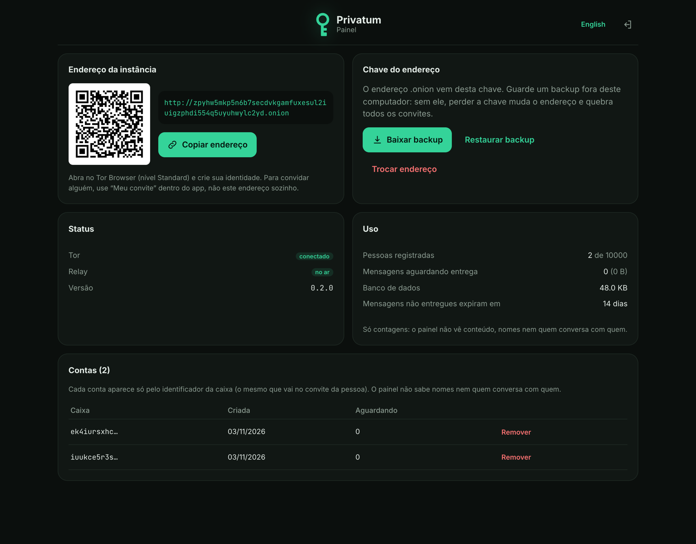

# Operação de uma instância

> Estado: Fase 1, pré-alfa. A instância serve o cliente web e a API do relay no mesmo endereço `.onion`. Leia [SECURITY.md](../SECURITY.md) antes.
>
> Para usar: abra o endereço `.onion` no Tor Browser no nível de segurança **Standard** (o cliente precisa de WebAssembly), crie uma identidade com uma senha local e envie o link de "Meu convite" a quem você quer adicionar.

## Subir

Requisito: Docker com Compose. Nada mais precisa ser instalado; Rust e Tor são compilados ou instalados dentro das imagens.

```bash
cd deploy
docker compose up -d
docker compose exec tor cat /run/onion/hostname
```

A última linha mostra o endereço `.onion` da instância. Na primeira vez, publicar o serviço pode levar alguns minutos.

## O que roda

| Contêiner | Usuário | Rede | Sistema de arquivos |
|---|---|---|---|
| `relay` | `65532` (distroless *nonroot*) | só `internal` (sem acesso à internet) | somente leitura; grava apenas em `/data` |
| `tor` | `debian-tor` | `internal` + `egress` | somente leitura; grava apenas em `/var/lib/tor` e `/run/onion` |
| `admin` | `100` (o mesmo do Tor) | `internal` + `admin` | somente leitura; grava apenas em `/admin` e no token interno |

O aplicativo não publica porta no host. A única porta publicada é a do **painel** (`127.0.0.1:8099` e `[::1]:8099`, mude com `PRIVATUM_INFO_PORT`), presa ao endereço local. O painel nunca é alcançável pelo `.onion`: o serviço onion só encaminha para a porta 8080 do relay. Todos os contêineres rodam sem *capabilities* e com `no-new-privileges`.

## Painel



O contêiner `admin` serve um painel em `http://127.0.0.1:8099`, só neste computador. No primeiro acesso você cria a senha (mínimo de 10 caracteres). Ele mostra o endereço `.onion` com QR code, o estado do Tor e do relay e contagens de uso (pessoas registradas, mensagens aguardando entrega, tamanho do banco), nunca conteúdo nem quem conversa com quem.

Como ele funciona sem virar uma brecha:

- **Sem acesso ao Docker da máquina.** Fala com o Tor pelo socket de controle dentro do volume do Tor (`/var/lib/tor/control`) e com o relay por uma API interna (porta 8081) que exige um token. O `.onion` não encaminha para nenhuma das duas.
- **Contra sites maliciosos abertos no mesmo computador:** recusa pedidos endereçados a outro nome que não `127.0.0.1`/`localhost` (DNS rebinding), exige um cabeçalho próprio em toda alteração e usa cookie `SameSite=Strict`.
- **Senha:** guardada como hash argon2id no volume `privatum_admin-data`; 10 tentativas erradas por minuto, no máximo. Esqueceu? Pare a instância, apague o volume `privatum_admin-data` e crie outra senha no próximo acesso (o endereço e as conversas não são afetados).

Qualquer programa rodando neste computador consegue abrir `127.0.0.1:8099`; a senha é o que protege o painel. Em máquina compartilhada, use uma senha forte.

## Quem entra e contas

Qualquer pessoa que tenha o endereço `.onion` pode criar uma identidade na instância (o limite é `PRIVATUM_MAX_MAILBOXES`). Para conversar, ela precisa do **Meu convite** de alguém, que leva o endereço da caixa dessa pessoa. O endereço é o que protege a instância: compartilhe só com quem você quer lá.

**Contas registradas** lista todas as caixas já criadas, online ou não (a instância não registra quem está online), pelo identificador (o mesmo que vai no convite de cada pessoa), a data de criação e quantas mensagens aguardam entrega. **Remover** apaga a caixa, as chaves públicas dela e as mensagens pendentes; os contatos deixam de conseguir escrever para ela. As conversas no navegador da pessoa continuam lá, e a conta é recriada sozinha, com a mesma identidade: em segundos, se o Privatum dela estiver aberto (ela vê um aviso de que a conta foi removida e recriada), ou na próxima vez que ela desbloquear. Remover **não impede ninguém de voltar**. Para manter alguém fora da instância, troque o endereço `.onion` e passe o novo só a quem deve continuar. Como o painel não sabe de quem é cada caixa, a remoção pede que você confira antes que não é a sua (o identificador da sua caixa aparece no link do seu **Meu convite**, depois de `#c=`).

## Volumes

| Volume | Conteúdo | Perder | Vazar |
|---|---|---|---|
| `privatum_tor-state` | `hs/hs_ed25519_secret_key` (chave do serviço onion) e cache do Tor | O endereço muda; **todos os convites quebram** | Outra pessoa pode se passar pela sua instância |
| `privatum_relay-data` | `relay.sqlite`: chaves públicas e mensagens cifradas ainda não entregues | Mensagens pendentes se perdem; as pessoas precisam se registrar de novo | Metadados (quem envia para quem, quando). Nenhum conteúdo em claro |
| `privatum_onion-hostname` | Só o nome `.onion`, para o relay | Recriado ao subir | Nada além do endereço |
| `privatum_admin-data` | Hash (argon2id) da senha do painel | Você cria uma senha nova no próximo acesso | Permite tentar descobrir a senha do painel por força bruta |
| `privatum_admin-token` | Token que o relay exige do painel | Recriado ao subir | Quem tiver o token e acesso à rede interna lê as contagens do relay |

## Backup da chave onion

A chave é o que identifica a instância. Faça backup cifrado e guarde fora da máquina.

**Pelo painel (recomendado):** cartão **Chave do endereço → Baixar backup**. Você escolhe uma senha (mínimo de 12 caracteres) e o navegador baixa um arquivo `.privatum-onion` já cifrado (PBKDF2 + AES-GCM, as mesmas primitivas do backup das conversas). A chave sai do contêiner só para o navegador deste computador, que a cifra antes de salvar. Para restaurar: **Restaurar backup**, escolha o arquivo e digite a senha. O painel confere se a chave privada corresponde ao endereço antes de gravar qualquer coisa; um arquivo corrompido é recusado e a chave atual fica intacta. Depois o Tor reinicia sozinho no endereço do backup.

**Pelo terminal:**

```bash
docker run --rm -v privatum_tor-state:/s:ro -v "$PWD":/out debian:bookworm-slim tar -C /s -cf /out/onion-key.tar hs
```

Depois cifre `onion-key.tar` (por exemplo com `age` ou `gpg --symmetric`) e apague a cópia em claro com `shred -u onion-key.tar` (ou o equivalente no seu sistema).

Para restaurar, com a instância parada: decifre o arquivo, extraia em `hs/` dentro do volume e mantenha dono `debian-tor` e permissão `0700` no diretório.

## Trocar o endereço `.onion`

O endereço não é escolhido nem registrado em lugar nenhum: o Tor o calcula a partir da chave privada em `privatum_tor-state` (`hs/hs_ed25519_secret_key`). Mesma chave, mesmo endereço, para sempre; chave nova, endereço novo.

**Pelo painel:** cartão **Chave do endereço → Trocar endereço**, digite `TROCAR` para confirmar. O painel apaga a chave e manda o Tor encerrar; o Docker o reinicia e o Tor cria um endereço novo em alguns segundos. O relay passa a usar o novo endereço sozinho. Baixe um backup antes, pelo mesmo cartão, se quiser poder voltar.

**Pelo terminal**, dentro de `deploy/`:

```bash
docker compose down
```

```bash
docker run --rm -v privatum_tor-state:/s debian:bookworm-slim rm -rf /s/hs
```

```bash
docker compose up -d
```

O novo endereço aparece no painel (link `admin-1` do Docker Desktop), nos logs e em `docker compose exec tor cat /run/onion/hostname`.

Depois da troca:

- **Convites antigos param de funcionar**: eles apontam para o endereço velho. Envie o novo endereço por um canal confiável.
- **Cada pessoa restaura o próprio backup no endereço novo.** Para o navegador, o endereço novo é outro site, então a identidade não aparece lá até ser restaurada com o arquivo `.privatum` e a senha local.
- **Contatos e mensagens pendentes continuam valendo**, porque o banco do relay (`privatum_relay-data`) não muda. Quem já conversava não precisa trocar convites de novo.

Quando faz sentido trocar: se a chave vazou (quem a tem pode se passar pela sua instância) ou para cortar o vínculo com um endereço que circulou demais. Para voltar a um endereço antigo, só restaurando o backup da pasta `hs` (seção anterior); sem ele, o endereço antigo está perdido.

## Quando o endereço `.onion` não abre

Ninguém se conecta diretamente à máquina: o navegador e a instância só fazem conexões de saída para a rede Tor. Firewall, roteador e "mesma rede Wi-Fi" não influenciam. Siga nesta ordem:

1. **A instância está no ar?** `docker compose ps` deve mostrar `relay`, `tor` e `admin` rodando. O computador precisa estar ligado e acordado (desative o repouso).
2. **O Tor do aparelho funciona com outros `.onion`?** Teste, por exemplo, `https://duckduckgogg42xjoc72x3sjasowoarfbgcmvfimaftt6twagswzczad.onion`. Se nem esse abre, o problema é o Tor do aparelho.
3. **O endereço começa com `https://`?** Precisa ser `http://`. A opção "Copiar link" do WhatsApp e de outros apps troca para `https://`, e aí o Tor Browser responde "Não foi possível conectar". Copie a mensagem (segurar → Copiar) em vez do link.
4. **Primeira visita:** depois de abrir o Tor Browser, o primeiro acesso pode demorar ou dar "a conexão expirou". Espere dois minutos e tente de novo; recarregar em sequência piora, porque o Tor guarda a falha por alguns minutos.
5. **Depois de reiniciar o `tor` ou mudar o `torrc`**, o serviço publica uma descrição nova na rede Tor. Por alguns minutos, alguns aparelhos ainda recebem a antiga e falham com "Não foi possível conectar". Espere de 10 a 15 minutos antes de concluir que não funciona.
6. **Guarda ruim:** se `docker compose logs tor` mostrar *"Guard … is failing more circuits than usual"* e o endereço falhar com frequência, faça o Tor escolher outro guarda. A chave do `.onion` não é tocada; o endereço continua o mesmo:

   ```bash
   docker compose stop tor
   ```

   ```bash
   docker run --rm -v privatum_tor-state:/s debian:bookworm-slim rm -f /s/data/state
   ```

   ```bash
   docker compose start tor
   ```

   O Tor mantém o mesmo guarda por meses de propósito (dificulta certos ataques de identificação), então só faça isso quando o guarda estiver de fato falhando.

O serviço é configurado com 5 pontos de introdução (o padrão do Tor é 3), o que dá aos visitantes mais caminhos de entrada quando parte dos circuitos falha.

## Conferir as imagens

As imagens publicadas (`ghcr.io/privatum-app/privatum-relay` e `ghcr.io/privatum-app/privatum-tor`) são compiladas pelo GitHub Actions (`.github/workflows/release.yml`), assinadas com **cosign** sem chave guardada (identidade OIDC do workflow) e acompanhadas de **SBOM** e de proveniência do build. O `compose.yaml` do pacote fixa cada imagem pelo digest, então o Docker recusa uma imagem trocada.

Para conferir a assinatura, use o **cosign 3** ou mais novo (troque a versão). Desde a v0.2.0 as imagens são assinadas com o cosign 3, que guarda a assinatura num formato novo: o cosign 2 responde “no signatures found” mesmo com a assinatura lá.

```bash
cosign verify ghcr.io/privatum-app/privatum-relay:v0.2.4 --certificate-oidc-issuer https://token.actions.githubusercontent.com --certificate-identity-regexp '^https://github.com/privatum-app/privatum-selfhosted/\.github/workflows/release\.yml@refs/tags/v'
```

Repita com `privatum-tor`. O resultado esperado inclui “The cosign claims were validated”; com outra identidade no lugar da do workflow, a verificação tem que falhar. Para ver o SBOM: `docker buildx imagetools inspect ghcr.io/privatum-app/privatum-relay:v0.2.4 --format '{{ json .SBOM }}'`.

A assinatura e o SBOM ficam no próprio pacote, como versões **sem etiqueta** criadas no mesmo horário da release. Ao limpar versões antigas no GitHub (Packages → Manage versions), nunca apague as sem etiqueta de uma release publicada: sem elas o `cosign verify` responde “no signatures found”.

## Atualizar

As imagens base e a versão do Tor são fixadas. Quando o Tor Project publica uma versão nova, o build do contêiner `tor` passa a falhar de propósito. Leia as notas da versão, ajuste `TOR_VERSION` em `deploy/tor.Dockerfile` e rode `docker compose build && docker compose up -d`.

## Anonimato de quem hospeda

O serviço onion esconde o IP do servidor de quem usa. Ele **não** esconde você do seu provedor de hospedagem: um VPS pago com cartão ou cadastrado no seu nome liga a instância a você. Veja o limite L6 em [THREAT-MODEL.md](THREAT-MODEL.md).

## Build reproduzível

Conferido em 2026-11-17: a imagem arm64 do relay da v0.2.3, montada no GitHub, e a mesma imagem montada num Mac (Apple Silicon) têm os 42 arquivos idênticos (binários do relay e do painel, cliente, painel web e WASM). Para repetir: `docker build -f deploy/relay.Dockerfile -t privatum-relay:local .` e compare os arquivos de `/usr/local/bin/privatum-*` e `/srv` com os da imagem publicada. O WASM é sempre compilado como linux/amd64, porque o compilador gera um WASM diferente conforme o processador da máquina; em outras máquinas essa etapa roda emulada e demora mais.

Ainda não conferido: a imagem amd64 do relay e a imagem do Tor (que instala pacotes do repositório do Tor).
